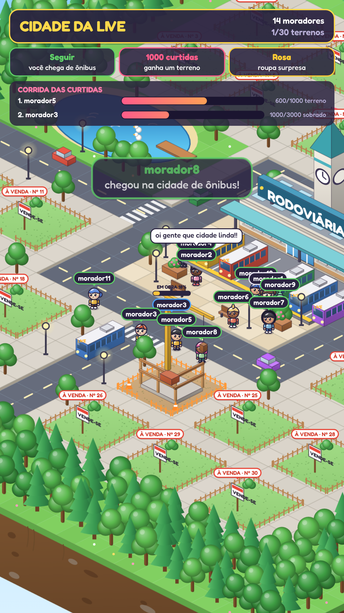

# TikCity 🏙️

Jogo de navegador para lives no TikTok. Quem segue a live vira um bonequinho chibi que chega de ônibus na rodoviária da cidade, ganha terreno com curtidas e troca de roupa com presentes. A tela é vertical (1080×1920) e fica pronta para colocar no OBS ou no TikTok LIVE Studio.

<p align="center"></p>

## Como funciona

| Na live | No jogo |
|---|---|
| **Seguir** | o boneco chega de ônibus com o nome em cima e vai para a praça |
| **Curtidas** (somando entre lives) | 1.000 = terreno (obra que vira casa), 3.000 = sobrado, 6.000 = prédio. Uma barrinha em cima do boneco mostra quanto falta |
| **Comentário** | aparece num balão em cima do boneco |
| **Compartilhar** | acessório (no máximo 1 a cada 5 min por pessoa) |
| **Entrar na live** | quem já tem casa sai pelo portão e a luz da casa acende |
| **Inscrever-se** | terreno na hora (ou a casa sobe de nível) + roupa épica ou melhor |
| **Fã-clube / Super Fã** | roupa rara ou melhor |
| **Baú de moedas** | festa na cidade + acessório para quem abriu |
| **Rosa** | roupa surpresa (comum, raro, épico ou lendário). A cor da etiqueta do nome mostra a raridade |
| **Presentes de 1 a 9 / 10 a 99 / 100 a 999 moedas** | acessório / roupa rara / terreno + roupa épica |
| **1.000 a 9.999 moedas** | terreno + roupa lendária + festa |
| **10.000+ moedas** | casa vira prédio na hora + roupa lendária + festa |
| **Especiais** | Confetti e Money Gun: + festa · Óculos de sol: óculos escuros · Bolo: roupa Festa + festa · Planeta e Foguete: prédio + Astronauta · Leão: prédio + Realeza · Universo: prédio + lendária + todos na tela ganham acessório |

Cada prêmio deixa a casa com um visual próprio: **Casa Estrela** (inscrição), **Casa de Doce** (Bolo), **Casa de Praia** (Óculos de sol), **Casa da Festa** (Confetti, Money Gun), **Mansão** (1.000 a 9.999 moedas), **Base Espacial** (Planeta, Foguete), **Castelo** (Leão) e **Torre Galáxia** (Universo, 10.000+). Quem ganha casa só com curtidas fica com a casa padrão. Os desenhos ficam em `public/js/casas-tema.js` e o tema de cada prêmio em `config.js` (`tema: '...'`).

### Leilão: quando os 30 terrenos acabam

Cada pessoa tem **pontos**: 1 curtida = 1 ponto, 1 moeda de presente = 10 pontos (100 moedas valem o mesmo que 1.000 curtidas) e inscrição = 1.000 pontos. Os pontos somam entre lives.

Quando a cidade lota:

1. O terreno do **dono mais fraco** (com menos pontos) ganha a etiqueta 🎯 MAIS FRACO.
2. Quem não tem casa e passa esse dono por **10% ou mais** (mínimo 1.000 pontos) e interagiu na live nos últimos 20 minutos abre um **desafio**.
3. Aparece na tela o painel ⚔️ DESAFIO com os pontos dos dois ao vivo e **60 segundos** para o dono se defender mandando curtidas e presentes.
4. No fim, se o desafiante ainda tiver mais pontos, **toma o terreno** (a casa é reconstruída para ele) e o antigo dono volta para a praça sem perder os pontos. Se o dono se defender, o terreno fica 🛡️ protegido por 3 minutos. O terreno recém-tomado também fica protegido por 3 minutos.

Um desafio por vez, com uma pausa de 8 segundos entre eles. Uma página extra do painel de regras explica o leilão e só aparece quando a cidade lotou. Tudo isso se ajusta em `leilao` no `config.js`. No painel de teste há botões para lotar a cidade, desafiar o mais fraco, defender e encerrar o desafio.

No topo da tela um painel troca de página a cada 8 segundos mostrando essas regras para quem está assistindo.

Onde cada boneco fica: chega de ônibus → praça em frente à rodoviária → quando a praça lota, passeia pelas ruas → quem tem casa fica no portão.

A cidade fica salva (no navegador e em `data/cidade.json`), então os moradores e as casas continuam na próxima live.

## Instalar (uma vez)

1. Instale o [Node.js](https://nodejs.org) versão 20 ou mais nova.
2. Baixe este repositório e, dentro da pasta, rode:

```bash
npm install
```

## Testar sem estar ao vivo

```bash
npm run simulacao
```

Abra **http://localhost:3000/?painel=1**. O painel do lado direito simula seguir, curtidas, rosas, outros presentes, comentários e tem uma "live automática" que gera eventos sozinha. A tecla **P** mostra ou esconde o painel.

Também dá para abrir `public/index.html` direto no navegador (dois cliques) e testar com o painel, sem servidor.

## Usar na live

> 📖 Guia completo (requisitos da conta, LIVE Studio x OBS, chave de transmissão, testes e problemas comuns): **[docs/COMO-FAZER-LIVE.md](docs/COMO-FAZER-LIVE.md)**

1. Coloque seu usuário do TikTok (sem @) em `config.servidor.json`, ou rode direto:

```bash
npm start -- seu_usuario
```

2. Comece a live e deixe o terminal aberto. Ele mostra "conectado na live" quando estiver tudo certo (se você ainda não estiver ao vivo, ele tenta de novo a cada 30 segundos).
3. No **OBS** ou no **TikTok LIVE Studio**, adicione uma fonte de **Navegador (Browser Source)**:
   - URL: `http://localhost:3000`
   - Largura `1080`, altura `1920`

Ao conectar, o servidor salva em `data/presentes-disponiveis.json` a lista de presentes da sua região com o valor em moedas, para ajudar a configurar.

> A conexão com a live usa a biblioteca [TikTok-Live-Connector](https://github.com/zerodytrash/TikTok-Live-Connector), que não é oficial do TikTok. Ela assina a conexão pelo serviço Euler Stream; se aparecer erro de limite, crie uma chave grátis em eulerstream.com e coloque em `chaveEulerStream` no `config.servidor.json`.

## Configurar

Tudo fica em **`public/config.js`** (é só editar e recarregar a página):

- `curtidas`: quantas curtidas para terreno, sobrado e prédio
- `chances`: chance de cada raridade de roupa
- `presentes.porNome`: ação para um presente específico (ex.: `'rose'`)
- `presentes.porMoedas`: ação por faixa de valor (1–9, 10–99, 100–999, 1.000–9.999, 10.000+)
- `compartilhar`, `inscrever`, `faclube`, `bau`: o que cada interação dá; `minutosEntreCompartilhar`, `entrarAcendeLuz`
- `painelDeRegras`: as páginas do painel no topo da tela (ícone, o que fazer, o que ganha) e `segundosPorPagina`
- `leilao`: pontos por curtida/moeda/inscrição, margem para desafiar, segundos de defesa e minutos de proteção
- `chegarAoComentar`: se quem só comenta também ganha boneco
- `nomeExibido`: mostrar o @ (`usuario`) ou o nome de exibição (`apelido`)

## Arquivos

```
server.js            servidor: site + conexão com a live + salvar a cidade
config.servidor.json usuário do TikTok, porta e chave Euler
public/config.js     regras do jogo (presentes, curtidas, chances)
public/js/mapa.js    desenho da cidade (mapa oficial v4, isométrico)
public/js/bonecos.js bonecos chibi "Vinil brilhante" e guarda-roupa
public/js/mundo.js   monta a cidade em camadas para os bonecos passarem atrás/na frente
public/js/casas-tema.js  casas temáticas de cada prêmio
public/js/jogo.js    regras, ônibus, câmera, etiquetas, avisos e efeitos
public/js/painel.js  painel de simulação
```
